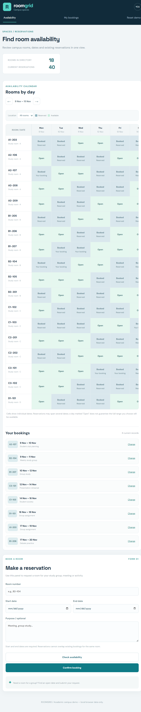
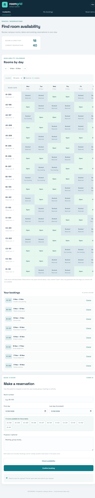

# Dorm Room Booking — ACL UI/UX Lab

This is a **standalone React demo** for one session of the UI/UX Rescue Challenge. It uses realistic example records stored in this browser; it does not connect to MongoDB or the previous lab API.

## Run

```bash
npm install
npm run dev
```

The terminal prints **one local URL**. Open that link in your normal external browser. The development server will **not** open a browser automatically. Press `Ctrl+C` to stop it.

## Functional brief

Users can browse bookings across an example directory of 18 rooms, create a booking, and change their own booking. Date ranges must be valid and overlapping bookings for the same room are rejected.

### Fields from the prior lab

- `roomNumber` — Room number: required text
- `startDate` — Start date: YYYY-MM-DD
- `endDate` — Last day: YYYY-MM-DD, inclusive in the form
- `purpose` — Purpose: optional

The demo supports create/edit and stores your updates in browser `localStorage` for this browser. **Reset demo** restores the example records. You can assume the current signed-in user is `You`.

The booking form treats both the first and last selected days as included. Existing demo records retain their exclusive end-date representation internally; the interface converts at the form boundary.

The **My bookings** navigation opens a dedicated dashboard for your reservations; selecting **Change** returns to availability and opens the edit form. Select the **YOU** profile button in the header to open the student profile dashboard.

## Usability rescue

1. **Find a room for the whole date range:** entering a first and last day shows every directory room available for all selected days, with buttons to choose a room directly. This avoids scanning each day in the calendar and mistaking a single open day for an available multi-day stay.
2. **Make date ranges predictable:** the form and booking cards show inclusive first/last days. The app converts the selected last day to its existing exclusive end date when saving, so stored sample bookings and overlap checks keep their original representation.
3. **Explain unsuccessful bookings:** conflicts name the reason and suggest changing rooms or dates; an unavailable selected room is also called out before submission. This replaces the previous generic failure message with an actionable one.

**Design trade-off:** A broad redesign suggestion was to replace the room-by-day grid with a separate search wizard. That would make date search prominent, but remove at-a-glance browsing and introduce a new mode. The implemented refinement keeps the existing calendar and adds date-matched room choices beside the booking fields.

**Demo:** To show the main action, enter `2026-11-09` as both days, choose an available room such as `A2-106`, and confirm. To show an unsuccessful action, choose `A1-203` for `2026-11-09` and check availability; the specific overlap is announced. Use **Reset demo** to restore the examples.

### Before and after

**Before**



**After**



## User scenario for this session

A student needs to find dates for a common room, reserve it, and later adjust their own reservation.

Your redesign should support the scenario above without removing or weakening the existing features.

## UI/UX Rescue Challenge (25–30 minutes)

**Your mission:** use this interface as an end user, find **at least three distinct, meaningful UI/UX problems**, and fix all three with AI assistance.

- Explain the user's goal and why each issue hurts usability.
- Ask AI to suggest alternatives and compare trade-offs before you implement a solution.
- Choose your own changes; there is no prescribed visual redesign.
- Preserve all working behavior and relevant validation.
- Demonstrate the main action, one unsuccessful action, and your three improvements.

**Submit:** the modified React files, before/after screenshots, three brief justifications, and one example of an AI design suggestion you refined or rejected.

**Evaluation:** We assess usability reasoning, design consistency, preserved functionality, and testing. Using AI is allowed and expected. Cosmetic changes alone are not sufficient.
