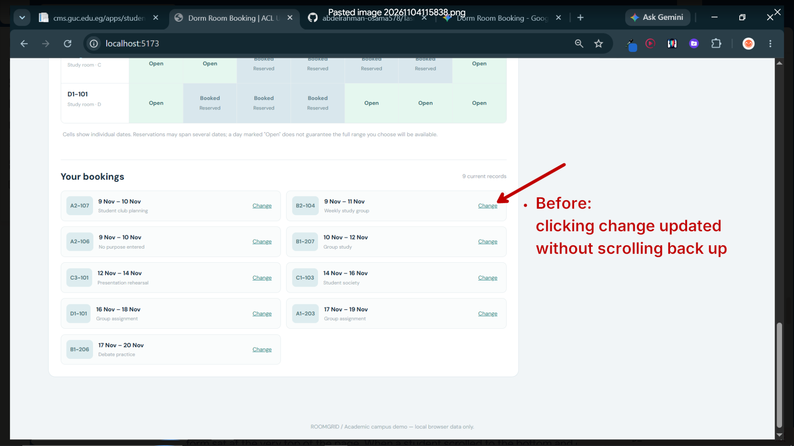
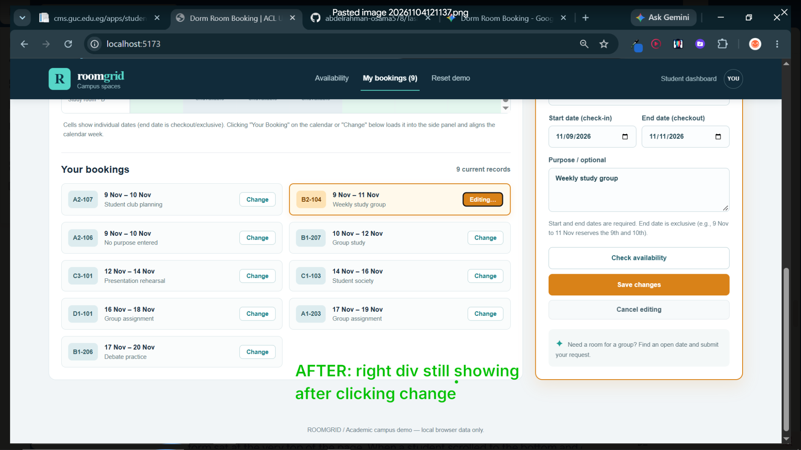
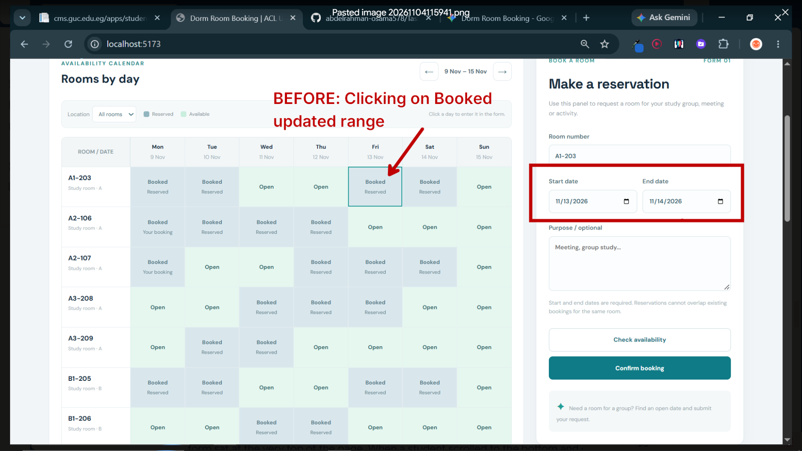
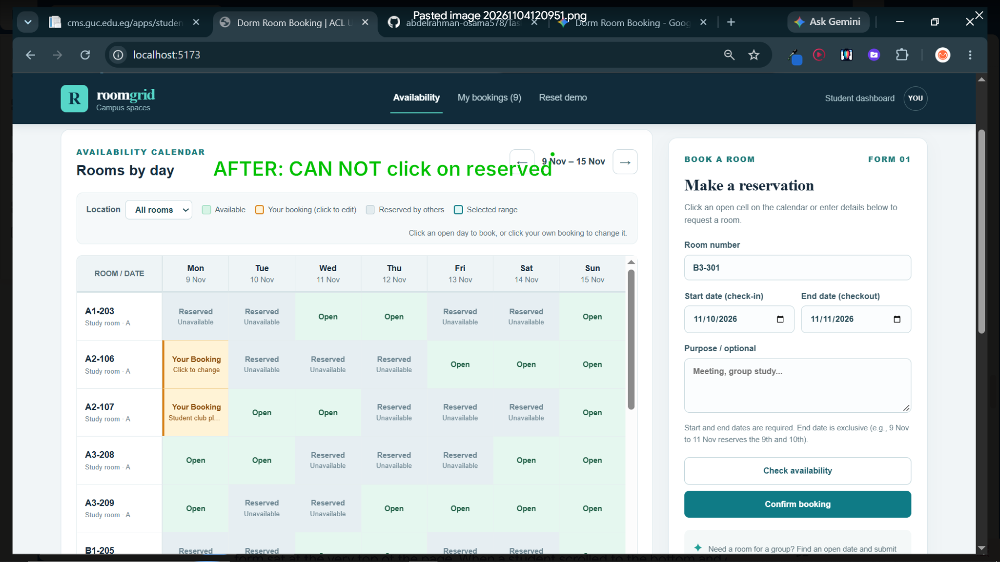
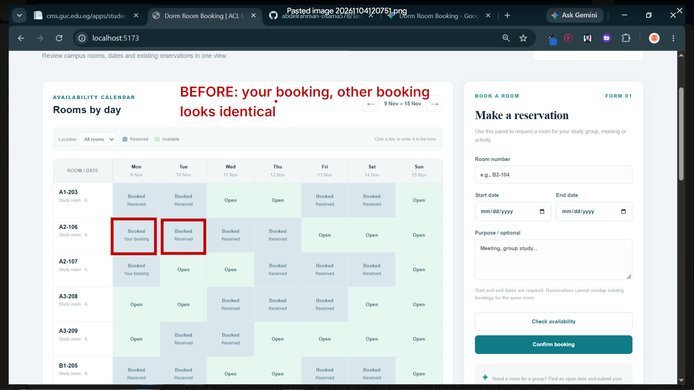
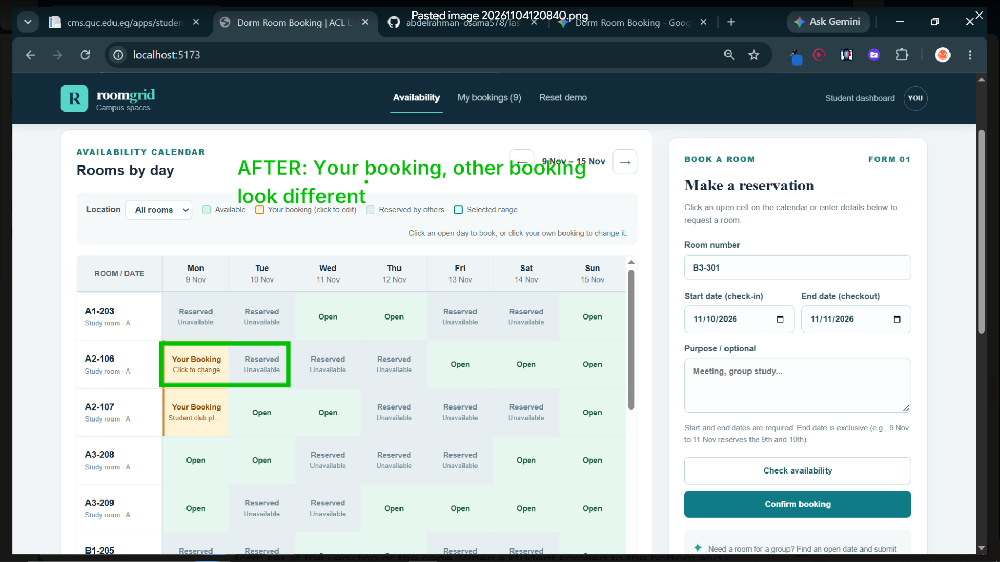

## Summary of 4 Core UI/UX Fixes

| #                    | Usability Problem                                                                | Heuristic Violated                                | Before                                                                                                                                                                             | After                                                                                                                                                                                                                                |
| -------------------- | -------------------------------------------------------------------------------- | ------------------------------------------------- | ---------------------------------------------------------------------------------------------------------------------------------------------------------------------------------- | ------------------------------------------------------------------------------------------------------------------------------------------------------------------------------------------------------------------------------------ |
| **Fix 1 (Issue #2)** | Disjointed "Change" action with zero viewport or visual feedback                 | Visibility of System Status & Spatial Mapping     | Clicking `Change` at the bottom of the page updated the top-right form off-screen without scrolling, sticky positioning, or highlighting the edited card.                          | `.booking-pane` is now sticky (`top: 94px`) on desktop, scrolls into view on mobile, highlights in amber (`EDIT MODE`), and marks the active card with `Editing…`.                                                                   |
| **Fix 2 (Issue #3)** | Indiscriminate calendar cell clicking & invisible form selection                 | Affordance, Error Prevention & Visible States     | Clicking *any* cell (even cells booked by others or by `you`) overwrote the form with a conflicting new reservation; selected dates were never shown on the grid.                  | Clicking `Open` selects the slot and highlights the range (`.selected-slot`); clicking `Your Booking` opens it in Edit Mode; `Reserved` (others) is disabled (`cursor: not-allowed`).                                                |
| **Fix 3 (Issue #4)** | "Your bookings" and "Others' bookings" looked identical on the grid              | Recognition Rather Than Recall & Visual Hierarchy | Both `you` and `other` cells used `.slot.taken` (`#d9e7ed`) with tiny `9px` text and no purpose shown. Legend only showed 2 states.                                                | Added a 4-state legend and `.slot.mine` (warm amber badge + left accent border) that displays the booking's `purpose` directly inside the calendar cell.                                                                             |
| **Fix 4 (Issue #5)** | Lost column headers on scroll, broken topbar tab sync, & unsynced calendar weeks | Memorability, Consistency & Easiness              | Scrolling down the 18-room table hid the `Mon–Sun` headers; clicking `Availability` in the topbar didn't scroll up; editing a future week's booking didn't move the calendar week. | Bounded `.calendar-scroll` (`max-height: 540px`) with sticky day headers and room column; topbar tabs scroll smoothly and sync on scroll; editing a booking automatically jumps the calendar to that booking's week (`getMonday()`). |